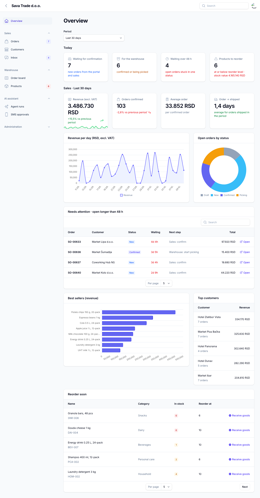
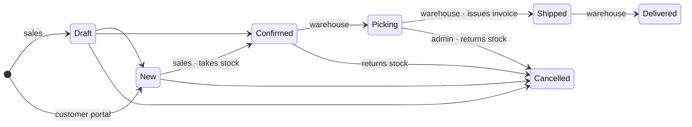
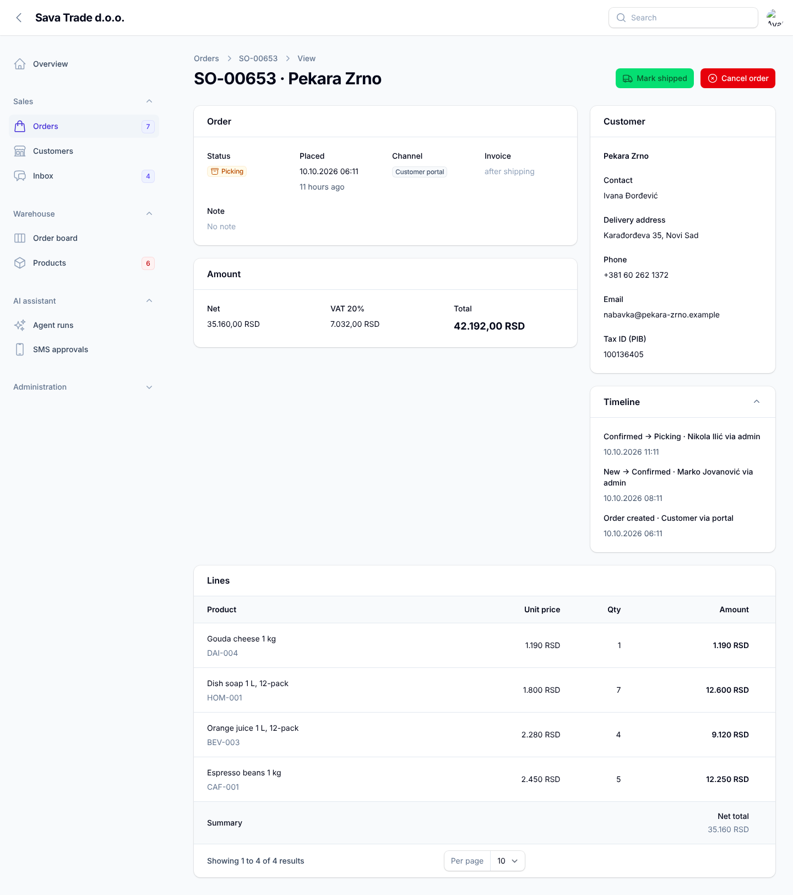
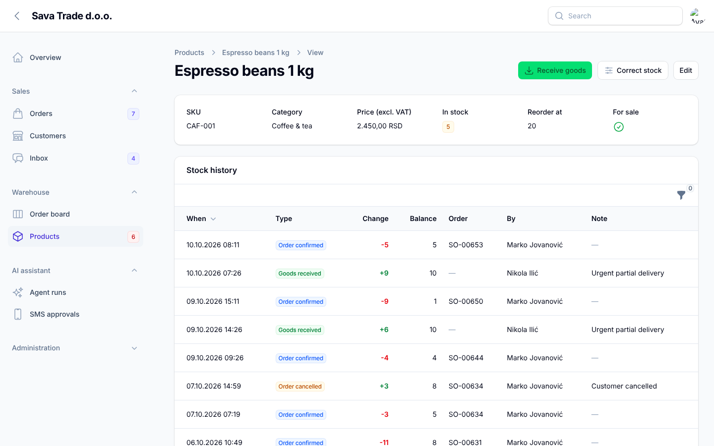
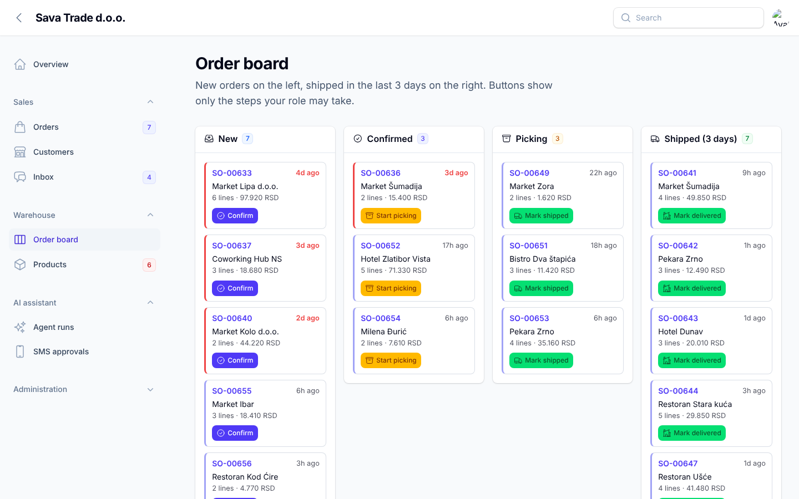
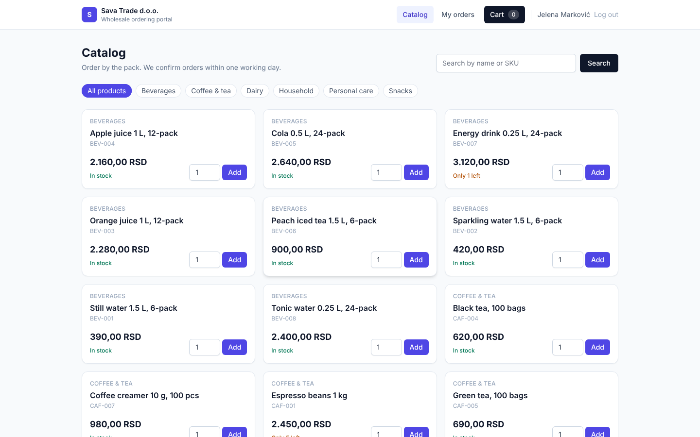
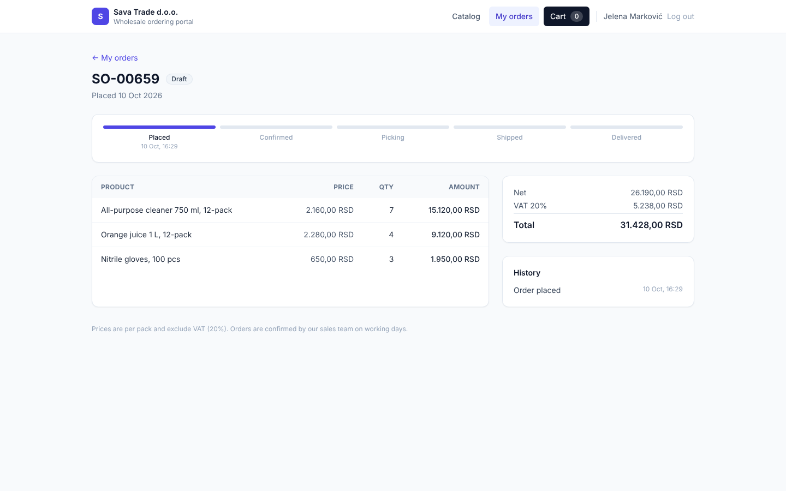
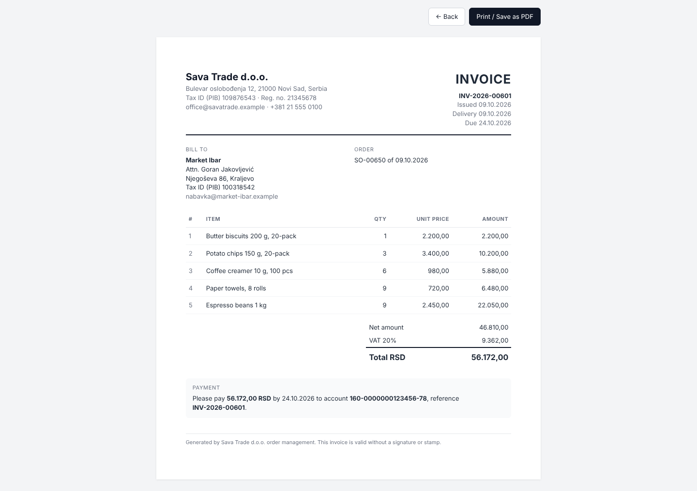

# Mini Order Admin

[](https://github.com/spasojewagner/mini-order-admin/actions/workflows/tests.yml)

Back office and customer portal for a wholesale distributor: business customers (shops, cafés, hotels) order online or through the sales team, the warehouse picks and ships, invoices go out with the goods, and an AI assistant keeps an eye on the backlog. The demo company is *Sava Trade d.o.o.*, a fictional distributor in Novi Sad.



## Who uses it

| Role | Works in | Can |
|---|---|---|
| **Sales** | Back office (`/admin`) | Customers, orders, confirming and cancelling orders, the inbox with AI reply drafts |
| **Warehouse** | Back office | Order board, picking, shipping, delivery, receiving goods, stock counts |
| **Admin** | Back office | Everything above, plus users and roles, settings, SMS approvals, running the AI agent |
| **Customer** | Portal (`/shop`) | Catalog, cart, ordering, order status, invoices, withdrawing an order before it is confirmed |

Each role sees only its own screens and buttons. The rules are enforced on the server for every channel, not just hidden in the UI.

## What it does

### Orders with a real lifecycle



- **One place for the rules.** `OrderWorkflow` is the only code that changes an order's status. The back office, the customer portal, the MCP server and the AI agent all go through it, so a step can't be skipped from any of them.
- **Stock taken at confirmation, all or nothing.** If one line is short, nothing changes. Rows are locked during the check, so two people can't sell the same last box.
- **Cancelling puts stock back.** Lines are locked once an order is confirmed.
- **Every change is in the order's timeline:** who did it, when, and through which channel (back office, portal, MCP, agent).
- **Invoices issued on shipping,** numbered per year (`INV-2026-00042`), with VAT. They print or save as PDF from the browser.
- **Customers get an email** when their order is confirmed, shipped, delivered or cancelled. A mail server failure is recorded in the timeline and does not undo the step.



### Stock you can explain

Stock changes in one way only: through `StockService`, which writes a movement each time: opening balance, goods received, order confirmed, order cancelled, stock correction or ERP sync. A product's stock always equals the sum of its movements (the demo data is tested for that). Every product has its own reorder level. Receiving goods and stock counts are buttons with a required reason; a count records the difference instead of overwriting the number.



### Dashboard and order board

- **Today:** orders to confirm, work for the warehouse, orders stuck in one status longer than the limit, and products to reorder.
- **Sales for any period:** revenue against the previous period, average order, days from order to shipment, revenue trend, best sellers and top customers. The warehouse doesn't see these.
- **Order board:** a kanban view where each role moves orders one column to the right with one click.



### Customer portal

Customers (or anyone who signs up with a company name and tax ID) browse the catalog, order by the pack, and follow each order from placed to delivered. Invoices are in the portal.

| Catalog | Order status |
|---|---|
|  |  |

### AI assistant

- **Order monitor agent** (`app:monitor-orders`, hourly). It reads the open orders and low stock through the same tools the MCP server exposes. When the backlog is above the limit, it emails the manager. In an emergency it drafts an SMS that waits for an admin to approve it, and it never sends one by itself. The thresholds live in Settings. Every run, with what its tools did, is under *Agent runs*, and an admin can start one from there.
- **Reply drafts in the inbox.** "Draft reply with AI" writes an answer to a customer conversation using that customer's real recent orders, statuses and invoice numbers, in the customer's language. The draft is marked as AI-written until someone edits it.

Both use Groq (`openai/gpt-oss-120b`) through `laravel/ai`.

### MCP server for AI clients

Claude Desktop, Cursor and other MCP clients can work with the system at `/mcp/order-admin` (Streamable HTTP).

**Tools:**

- products
- customer search
- orders
- one order with its timeline
- low stock
- sales summary
- create order
- change order status

The tools sit behind a search catalog, so the client sees two tools instead of eight.

**Access:**

- Every request needs a staff API token. Create one in the panel (user menu → *API tokens*) or with `php artisan app:mcp-token you@company.com`.
- The token acts with its owner's role: a warehouse token cannot confirm orders, and a customer token is refused.

```json
{
  "mcpServers": {
    "order-admin": {
      "command": "npx",
      "args": ["mcp-remote", "http://localhost:8000/mcp/order-admin", "--header", "Authorization: Bearer YOUR_TOKEN"]
    }
  }
}
```



## Tech

Laravel 12 · PHP 8.4 · Filament 5 (back office) · Inertia + React 18 + Tailwind (portal) · Laravel MCP · Laravel AI (Groq) · Sanctum · SQLite · PHPUnit · Pint · GitHub Actions

```
app/
  Enums/OrderStatus.php          statuses and the allowed transitions
  Services/OrderWorkflow.php     create orders, move them through their life
  Services/StockService.php      the only writer of stock, with a movement per change
  Services/InvoiceNumbers.php    INV-YYYY-NNNNN
  Support/SalesReport.php        numbers for the dashboard and the AI tools
  Support/Settings.php           company details and thresholds, editable in the panel
  Mcp/                           MCP server and tools
  Ai/                            order monitor agent, reply draft agent, their tools
  Filament/                      back office: resources, dashboard widgets, board, settings
  Http/Controllers/              customer portal and invoices
database/seeders/DemoDataSeeder  six months of a distributor, consistent to the last box
```

## Running it

```bash
composer install
npm install && npm run build
cp .env.example .env
php artisan key:generate
php artisan migrate:fresh --seed      # demo data: ~650 orders over six months
php artisan serve
```

- Back office: http://localhost:8000/admin
- Customer portal: http://localhost:8000/shop

All demo accounts use the password `password`:

| Role | Email |
|---|---|
| Admin | `admin@demo.test` |
| Sales | `sales@demo.test` |
| Warehouse | `warehouse@demo.test` |
| Customer (portal) | `shop@demo.test` |

For the hourly order monitor, keep `php artisan schedule:work` running, or click *Run order monitor now* under *Agent runs*. Both need `GROQ_API_KEY` in `.env`.

### Email (e.g. Gmail)

Emails are written to `storage/logs/laravel.log` by default. To send real ones through Gmail, use an app password (Google account → Security → App passwords) and add to `.env`:

```dotenv
MAIL_MAILER=smtp
MAIL_HOST=smtp.gmail.com
MAIL_PORT=587
MAIL_SCHEME=smtp
MAIL_USERNAME=you@gmail.com
MAIL_PASSWORD=your-app-password
MAIL_FROM_ADDRESS=you@gmail.com
MAIL_ALWAYS_TO=you@gmail.com   # locally: every email goes to you, never to demo customers
ORDER_ALERT_RECIPIENT=you@gmail.com
```

Check the setup with `php artisan app:mail-test`.

### Other commands

| Command | |
|---|---|
| `php artisan app:monitor-orders` | run the AI order monitor once |
| `php artisan app:mcp-token {email}` | API token for an MCP client |
| `php artisan app:sync-products --path=file.json` | import products and stock from an ERP export |
| `php artisan app:mail-test {to?}` | send a test email |

## Tests

```bash
npm run build        # two tests render pages that need the Vite manifest
php artisan test     # 105 tests
vendor/bin/pint --test
```

The tests cover:

- the order lifecycle: stock, invoices, emails, the timeline, and the role rules
- the stock ledger
- the MCP server: tokens, roles, and every tool
- both AI agents, with faked model responses
- the portal
- the back-office buttons and every screen for every role
- the consistency of the demo data

CI runs them on every push and pull request.

## Background

This started as an internship project for learning the Laravel stack: plain controllers, then Livewire, then Filament, an MCP server and an AI agent. It was later rebuilt into one coherent product. The duplicate screens were removed, the business rules moved into one workflow, and the stock ledger, invoices, dashboard, portal and role model were added.
